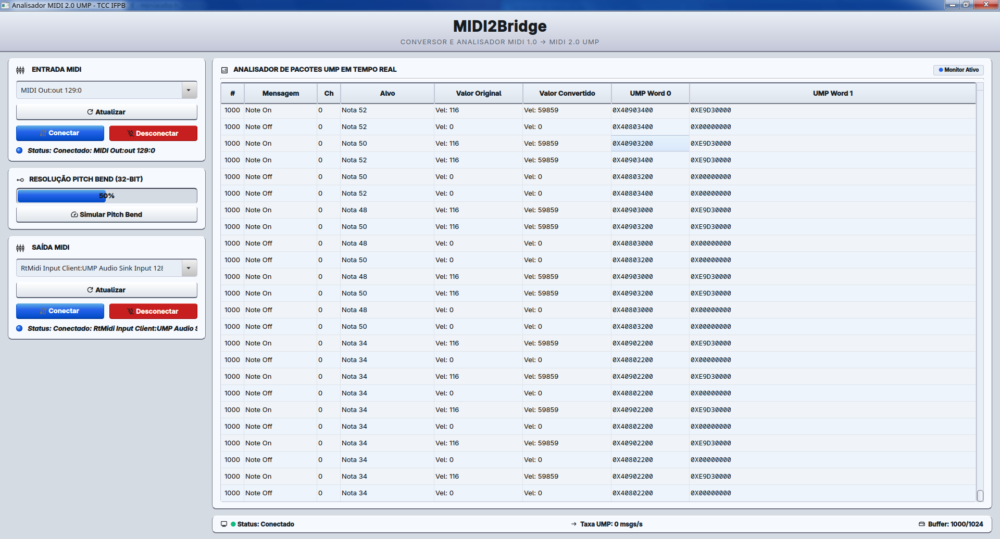
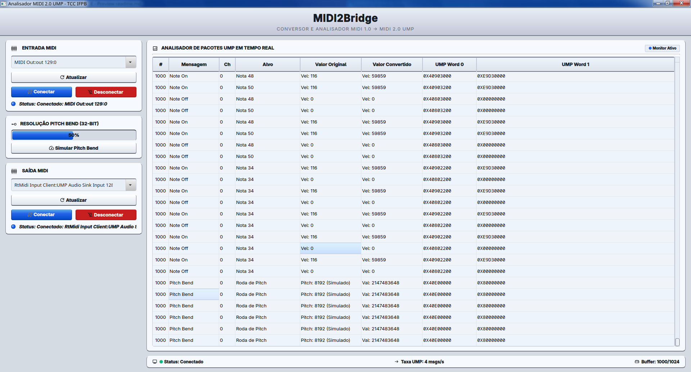
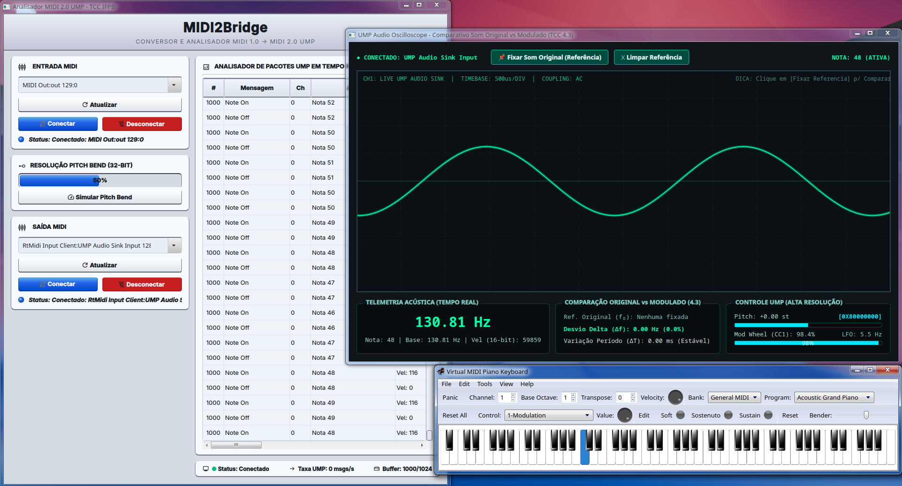

# 🎹 Conversor e Analisador MIDI 1.0 para MIDI 2.0 (UMP) - Versão C++

Bem-vindo à versão de alta performance do meu Trabalho de Conclusão de Curso (TCC) desenvolvido no **Instituto Federal da Paraíba (IFPB)** - Campus Campina Grande.

Originalmente concebido em Python, este projeto foi portado para **C++17** utilizando o framework **Qt6** para garantir latência ultra-baixa no processamento de pacotes **UMP (Universal MIDI Packet)**, uma interface gráfica robusta e uma bancada de validação acústica em tempo real com osciloscópio digital.

> 🔗 **Projeto original em Python:** [github.com/LucasRamosSilva-15/midi-ump-bridge](https://github.com/LucasRamosSilva-15/midi-ump-bridge)

---

## 🎥 Demonstração em Vídeo

[Assista à demonstração no Google Drive](https://drive.google.com/file/d/1uy8M-NuNLCTuwC7DK9pBds0iCnk3s3lD/view?usp=sharing)

---

## 📑 Sumário

- [Funcionalidades](#-funcionalidades)
- [O que é MIDI?](#-o-que-é-midi)
- [Sobre o Projeto](#-sobre-o-projeto)
- [Tecnologias Utilizadas](#-tecnologias-utilizadas)
- [Ecossistema de Aplicações](#-ecossistema-de-aplicações)
- [Demonstração Visual](#-demonstração-visual)
- [Estrutura do Código](#-estrutura-do-código)
- [Guia de Compilação e Execução (Linux)](#-guia-de-compilação-e-execução-linux)
- [Guia de Compilação e Execução (Windows)](#-guia-de-compilação-e-execução-windows)
- [Como Rodar a Bancada Completa de Testes](#-como-rodar-a-bancada-completa-de-testes)
- [Validação e Comparação Acústica (Dual-Trace)](#-validação-e-comparação-acústica-dual-trace)
- [Hardware de Teste](#-hardware-de-teste)
- [Autor e Orientação](#-autor-e-orientação)

---

## 🚀 Funcionalidades

- **Captura em Tempo Real:** Escuta dispositivos e controladores MIDI 1.0 físicos e virtuais sem bloqueio de thread.
- **Tradução UMP MT4:** Converte eventos legados de *Note On*, *Note Off*, *Control Change* e *Pitch Bend* para pacotes de 64 bits (*Message Type 4* - MIDI 2.0 Channel Voice).
- **Expansão de Resolução Matemática:**
  - *Velocity* escalonada de 7 bits ($[0, 127]$) para 16 bits ($[0, 65535]$) com saturação plena conforme as diretrizes oficiais da *MIDI Association*.
  - *Pitch Bend* e *Control Change* projetados para resolução contínua de 32 bits ($[0, 4294967295]$).
- **Interface Gráfica Analisadora (Qt6):** Exibição em tempo real do log de pacotes, canais, notas e palavras hexadecimais UMP.
- **Osciloscópio Digital Acústico Integrado:** Sintetizador e osciloscópio gráfico de 60 FPS com modo comparativo **Dual-Trace (Canal Duplo)** para confrontar o som original de referência com o som modulado.

---

## 🎼 O que é MIDI?

Se você não é da área de tecnologia musical, uma boa regra para entender o MIDI (*Musical Instrument Digital Interface*) é: **MIDI não é áudio, é partitura digital.**

Diferente de um arquivo MP3 ou WAV (que gravam ondas sonoras prontas), o protocolo MIDI transmite **instruções de controle**:
* **Qual nota foi tocada?** (identificador numérico da tecla, ex: 60 para o Dó Central);
* **Com que força a tecla foi pressionada?** (*Velocity*, indicando a intensidade de execução);
* **Quando a nota foi liberada?** (*Note Off*);
* **Controles contínuos e modulação:** Alavanca de *Pitch Bend* (desvio de afinação) ou roda de modulação.

O computador ou sintetizador recebe esses comandos e sintetiza o som instantaneamente.

---

## 🛠️ Sobre o Projeto

Esta Prova de Conceito (PoC) atua como a ponte tecnológica entre o protocolo clássico MIDI 1.0 (de resolução restrita a 7/14 bits) e o novo padrão da indústria **MIDI 2.0 UMP** (palavras estruturadas de 32/64 bits). 

O sistema elimina o histórico problema de *zipper noise* (ruído de degrau audível nas transições) e garante determinismo temporal estrito através de uma arquitetura multithread desacoplada em C++.

---

## 💻 Tecnologias Utilizadas

- **Linguagem:** C++17
- **Framework GUI:** Qt 6 (Módulos `Widgets`, `Core`, `Gui`, `Svg`)
- **Drivers de Entrada/Saída MIDI:** [RtMidi 6.0.0](https://github.com/thestk/rtmidi) (com suporte nativo a ALSA no Linux e WinMM no Windows)
- **Motor de Áudio e Síntese DSP:** [miniaudio](https://miniaud.io) (áudio analógico estéreo a 48.000 Hz sem dependências pesadas)
- **Build System:** CMake 3.16+
- **Especificação:** Padrão oficial MIDI 2.0 / Universal MIDI Packet (UMP M2-104-UM)

---

## 📦 Ecossistema de Aplicações

O projeto compila três alvos executáveis complementares:

1. **`MIDI2Bridge`:** A aplicação principal. Contém a interface gráfica skeuomórfica, gerenciador de conexões seriais/USB e motor de conversão de pacotes UMP em tempo real.
2. **`ump_oscilloscope`:** Ferramenta gráfica de laboratório que recebe os pacotes UMP via porta virtual, sintetiza o tom sonoro e exibe o osciloscópio digital em tempo real com modo comparativo *Dual-Trace*.
3. **`ump_audio_sink`:** Receptor utilitário de console leve para bancadas de teste headless e validação acústica rápida.

---

## 📸 Demonstração Visual

Abaixo, a bancada experimental completa rodando em regime de concorrência: o controlador virtual (*VMPK*), a ponte (*MIDI2Bridge*) auditando os pacotes e o osciloscópio (*ump_oscilloscope*) comparando a onda de referência com a onda modulada:





---

## 📁 Estrutura do Código

```text
midi_ump_bridge_cpp/
├── src/
│   ├── main.cpp              # Ponto de entrada do MIDI2Bridge
│   ├── gui.h / gui.cpp       # Janela principal em Qt6 e telemetria
│   ├── ump.h                 # Estrutura de dados UMP de 64 bits e análise binária
│   └── converter.h / .cpp    # Algoritmo de bit-shifting e upscaling matemático
├── tools/
│   ├── ump_oscilloscope_main.cpp  # Interface e lógica do osciloscópio digital
│   ├── oscilloscope.h             # Widget QPainter para renderização da grade/ondas
│   └── ump_audio_sink.cpp         # Receptor de teste sonoro em linha de comando
├── third_party/
│   └── miniaudio.h           # Biblioteca de reprodução de áudio em tempo real
├── tests/
│   └── converter_tests.cpp   # Testes unitários do conversor UMP
├── capturas/                 # Imagens e evidências para a monografia do TCC
├── resources.qrc             # Recursos vetoriais e ícones SVG
└── CMakeLists.txt            # Configuração e orquestração de compilação
```

---

## 🐧 Guia de Compilação e Execução (Linux)

Distros baseadas em Debian/Ubuntu/Fedora:

### 1. Instalando Dependências
```bash
# Ubuntu / Debian / Pop!_OS
sudo apt update
sudo apt install build-essential cmake qt6-base-dev libqt6svg6-dev libasound2-dev

# Fedora
sudo dnf install gcc-c++ cmake qt6-qtbase-devel qt6-qtsvg-devel alsa-lib-devel
```

### 2. Compilando Todos os Alvos
```bash
mkdir -p build && cd build
cmake ..
make -j$(nproc)
```

---

## 🪟 Guia de Compilação e Execução (Windows)

Requer o **Visual Studio 2022** (com suporte a C++), **CMake** e **Qt6 (MSVC 2022 64-bit)**:

```bash
mkdir build && cd build
cmake ..
cmake --build . --config Release
```

Os binários serão gerados na pasta `build/Release/`.

---

## 🔬 Como Rodar a Bancada Completa de Testes

Para reproduzir o experimento de validação acústica do TCC:

1. **Abra o Osciloscópio Digital:**
   ```bash
   ./build/ump_oscilloscope
   ```
   *(Ele iniciará o subsistema de áudio e criará automaticamente a porta virtual `UMP Audio Sink Input`)*.

2. **Abra a Ponte (`MIDI2Bridge`):**
   ```bash
   ./build/MIDI2Bridge
   ```
   - Em **Entrada MIDI**: Selecione o seu teclado físico ou o teclado virtual (*VMPK*);
   - Em **Saída MIDI**: Selecione **`UMP Audio Sink Input`**;
   - Clique em **Conectar / Iniciar**.

3. **Toque e Valide:**
   - Ao tocar as teclas, o áudio soará limpo nos fones/caixas de som e a onda senoidal se desenhará na tela do osciloscópio a 60 FPS.
   - Pressione **Espaço** ou clique em **`[ 📌 Fixar Som Original ]`** para congelar a onda de referência (traço azul).
   - Movimente o *Pitch Bend*: a onda verde se comprimirá ou expandirá em tempo real sobre a referência azul, exibindo o desvio em Hertz ($\Delta f$) e a variação do período temporal ($\Delta T$).

---

## 🧪 Validação e Comparação Acústica (Dual-Trace)

A bancada foi validada comparando o comportamento da forma de onda no domínio do tempo e da frequência:

| Parâmetro de Análise | Som Original (Referência) | Som Modulado (Pitch Bend / Nota Ativa) |
| :--- | :---: | :---: |
| **Canal no Osciloscópio** | **CH1 (Azul Tracejado)** | **CH2 (Verde Contínuo)** |
| **Frequência Fundamental** | $f_0$ estabilizada | $f(t)$ variando dinamicamente |
| **Período da Onda** | $T_0 = rac{1}{f_0}$ | $T(t)$ comprimido ou alargado |
| **Resolução de Controle** | 7 bits (MIDI 1.0) | 32 bits contínuos (MIDI 2.0 UMP) |
| **Comportamento Dinâmico** | Estático de repouso | Transição contínua sem *zipper noise* |

---

## 🎹 Hardware de Teste

- **Teclado Físico Homologado:** Yamaha PSR E383 (USB-MIDI).
- **Controlador Virtual:** Virtual MIDI Piano Keyboard (VMPK).
- **Roteamento Serial:** ALSA Virtual RawMIDI / virmidi (Linux) e loopMIDI (Windows).

---

## 👨‍💻 Autor e Orientação

- **Autor:** Lucas Ramos Silva ([GitHub](https://github.com/LucasRamosSilva-15))
- **Instituição:** Instituto Federal de Educação, Ciência e Tecnologia da Paraíba (IFPB) - Campus Campina Grande
- **Orientador:** Prof. Carlos Henrique Alencar